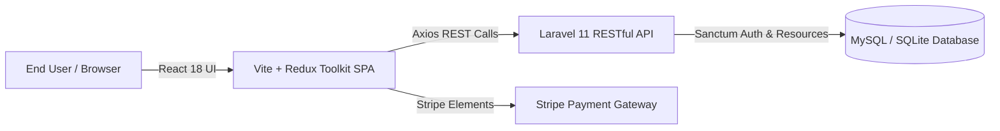

# 🛒 Modern Fullstack E-Commerce Platform

[](https://laravel.com/)
[](https://react.dev/)
[](https://vitejs.dev/)
[](https://redux-toolkit.js.org/)
[](https://stripe.com/)
[](https://getbootstrap.com/)

> A decoupled, enterprise-ready Fullstack E-Commerce solution featuring a robust **Laravel 11 RESTful API** backend and a responsive, high-performance **React 18 Single-Page Application (SPA)** powered by **Redux Toolkit** and **Vite**.

---

## 🌟 Architecture Overview



The application is structured as a decoupled monorepo:
* **`e-backend/`**: Laravel 11 API service handling authentication, product catalogs, discount coupon validation, order lifecycles, and reviews.
* **`frontend/`**: Modern React 18 frontend leveraging Redux Toolkit for unified cart, auth, and catalog state management, paired with Stripe Elements for seamless checkout.

---

## 🚀 Key Features

### 🔧 Backend (`e-backend`) — Laravel 11
- **Product & Inventory Engine:** Support for complex product variations including multi-color and multi-size combinations.
- **Dynamic Coupon System:** Percentage and fixed discount rules with expiration validation and minimum purchase thresholds.
- **Order Management:** Lifecycle tracking from checkout to fulfillment with customer invoice generation.
- **Customer Reviews & Ratings:** Verified review submission with moderation and aggregate star ratings.
- **Admin Dashboard APIs:** Dedicated endpoints for catalog management, sales reporting, and order status progression.
- **Security & Best Practices:** Form request validation, Eloquent API resources, CORS configuration, and credential isolation.

### 💻 Frontend (`frontend`) — React 18 & Vite
- **Blazing Fast DX:** Bundled with Vite for instant Hot Module Replacement (HMR).
- **Predictable State:** Centralized store with `@reduxjs/toolkit` managing shopping cart items, quantity adjustments, and user sessions.
- **Stripe Payments Integration:** `@stripe/react-stripe-js` implementation guaranteeing PCI-DSS compliant checkout without storing raw card data.
- **Responsive Design:** Optimized mobile-first layouts using Bootstrap 5 and customized modern CSS components.

---

## 📂 Project Structure

```text
Laravel11-Ecom/
├── e-backend/                  # Laravel 11 API Backend
│   ├── app/
│   │   ├── Http/Controllers/   # Admin & User REST API Controllers
│   │   ├── Models/             # Product, Order, Coupon, Review, Size, Color
│   │   └── Http/Requests/      # Form validation classes
│   ├── config/                 # Laravel system configurations
│   ├── database/migrations/    # Database schema migrations
│   └── routes/api.php          # RESTful endpoint definitions
└── frontend/                   # React 18 + Vite Frontend
    ├── src/
    │   ├── components/         # Reusable UI widgets (Cart, ProductCard, Navbar)
    │   ├── redux/              # Redux slices, actions, and root store
    │   ├── helpers/            # Axios API client & utility formatters
    │   ├── App.jsx             # Route definitions and layout wrapper
    │   └── main.jsx            # Application entrypoint
    ├── package.json
    └── vite.config.js
```

---

## 🛠️ Quick Start & Setup Guide

### 1. Backend Setup (`e-backend`)
```bash
cd e-backend
composer install
cp .env.example .env
php artisan key:generate
php artisan migrate --seed
php artisan serve --port=8000
```

### 2. Frontend Setup (`frontend`)
```bash
cd ../frontend
npm install
npm run dev
```
Open `http://localhost:5173` in your browser.

---

## 🧪 Testing & Code Quality
- **Backend Quality:** Fully testable with PHPUnit / Pest.
- **Frontend Quality:** ESLint 9 configuration with strict React rules.

---

## 📄 License
This repository is released under the MIT License.
