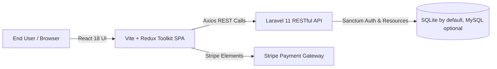

# 🛒 Modern Fullstack E-Commerce Platform

[](https://laravel.com/)
[](https://react.dev/)
[](https://vitejs.dev/)
[](https://redux-toolkit.js.org/)
[](https://stripe.com/)
[](https://getbootstrap.com/)

> A decoupled Fullstack E-Commerce solution featuring a **Laravel 11 RESTful API**
> backend and a responsive **React 18 Single-Page Application (SPA)** powered by
> **Redux Toolkit** and **Vite**. This is a starter project: there
> is no CI pipeline and no live deployment claim here — run it locally as below.

---

## 🌟 Architecture Overview



The application is structured as a decoupled monorepo:
* **`e-backend/`**: Laravel 11 API service handling authentication, product catalogs, discount coupon validation, order lifecycles, and reviews. It also serves a Blade admin panel (see `e-backend/routes/web.php`).
* **`frontend/`**: React 18 frontend leveraging Redux Toolkit for unified cart, auth, and catalog state management, paired with Stripe Elements for checkout.
* **`img/`**: Sample product images kept intentionally in the repository (21 files, about 4.0 MB after removing one exact duplicate — see below). They are placeholder/demo product photos (apparel and similar) for manual upload through the admin panel, not product data loaded by the code. Verified 2026-11-01: no `img/` filename is referenced by application code, Blade views, frontend code, or seeders, and the seeders contain no product seed data (admin seeder only); product images at runtime come from admin-panel uploads to `storage/images/products/`, not from `img/`. The one exact duplicate copy, `img/t1_werkpants_mens_olive_flat_lay_4825e693-f588-4813-bff0-1d4c46ce82ce (1).jpg` (identical MD5 to the same-named file without ` (1)`), was removed; the original file is kept, so no unique sample image was lost.

---

## 🚀 Key Features

### 🔧 Backend (`e-backend`) — Laravel 11
- **Product & Inventory Engine:** Support for complex product variations including multi-color and multi-size combinations.
- **Dynamic Coupon System:** Percentage and fixed discount rules with expiration validation and minimum purchase thresholds.
- **Order Management:** Lifecycle tracking from checkout to fulfillment and order status progression.
- **Customer Reviews & Ratings:** Verified review submission with moderation and aggregate star ratings.
- **Admin Dashboard APIs:** Dedicated endpoints for catalog management and order status progression, plus a Blade admin panel.
- **Security & Best Practices:** Form request validation, Eloquent API resources, Laravel's framework-default CORS handling, and credential isolation (secrets live in `.env`, never in the code).

### 💻 Frontend (`frontend`) — React 18 & Vite
- **Fast DX:** Bundled with Vite for instant Hot Module Replacement (HMR).
- **Predictable State:** Centralized store with `@reduxjs/toolkit` managing shopping cart items, quantity adjustments, and user sessions (persisted with `redux-persist`).
- **Stripe Payments Integration:** `@stripe/react-stripe-js` with Stripe Elements, so raw card data is handled by Stripe and is not stored by this application. Stripe only works with real test keys (see below); the code falls back to a `pk_test_sample` placeholder, which cannot complete a payment.
- **Responsive Design:** Mobile-first layouts using Bootstrap 5 and customized modern CSS components.

---

## 📂 Project Structure

```text
laravel11-react-ecommerce/
├── README.md                   # This file — start here
├── LICENSE                     # MIT
├── e-backend/                  # Laravel 11 API Backend + Blade admin
│   ├── app/
│   │   ├── Http/Controllers/   # Admin & Api REST controllers
│   │   ├── Models/             # Product, Order, Coupon, Review, Size, Color
│   │   └── Http/Requests/      # Form validation classes
│   ├── config/                 # Laravel system configurations
│   ├── database/migrations/    # Database schema migrations
│   ├── database/seeders/       # Admin seeder only (no product seed data)
│   ├── resources/views/admin/  # Blade admin panel
│   ├── routes/api.php          # RESTful endpoint definitions
│   └── routes/web.php          # Blade admin routes
├── frontend/                   # React 18 + Vite Frontend
│   ├── src/
│   │   ├── components/         # Cart, Product, Checkout, User, Reviews
│   │   ├── redux/              # Redux slices and root store
│   │   ├── helpers/            # Axios API client (see config.js)
│   │   ├── App.jsx             # Route definitions
│   │   └── main.jsx            # Application entrypoint
│   ├── package.json
│   └── vite.config.js
└── img/                        # 21 sample product images, ~4.0 MB (not code-referenced; see above)
```

> Note: there is no app at the repository root. Do not run `npm install` at the
> root — the JavaScript projects live in `frontend/` (the storefront) and in
> `e-backend/` (Blade admin assets only). The root `package.json` that used to
> duplicate one frontend dependency has been removed. Likewise, `react-simple-star-rating`
> was removed from `e-backend/package.json` and its lockfile: it is used only by
> `frontend/` (where it is still listed), while `e-backend/resources/js/` imports
> only `bootstrap` (axios) — so the e-backend listing was a stray copy, not a real
> dependency of the Blade admin assets.

---

## 🛠️ Quick Start & Setup Guide

### 1. Backend Setup (`e-backend`)
```bash
cd e-backend
composer install
cp .env.example .env
php artisan key:generate
php artisan migrate --seed
php artisan serve --port=8000
```

The default database is SQLite (`DB_CONNECTION=sqlite` in `.env.example`).
For MySQL, set `DB_CONNECTION`, `DB_HOST`, `DB_DATABASE`, `DB_USERNAME`
and `DB_PASSWORD` in `.env` instead.

Stripe keys (test mode) go in `e-backend/.env`:
```bash
STRIPE_KEY=
STRIPE_SECRET=
```

### 2. Frontend Setup (`frontend`)
```bash
cd ../frontend
npm install
npm run dev
```
Open `http://localhost:5173` in your browser.

Frontend environment variables (see `frontend/.env.example`):
```bash
VITE_API_BASE_URL=http://localhost:8000/api
VITE_STRIPE_PUBLIC_KEY=pk_test_your_test_key_here
```
`VITE_API_BASE_URL` defaults to `http://localhost:8000/api` when unset, matching
the backend step above. Without a real Stripe test publishable key, checkout
cannot complete a payment — that is expected, not a bug in the demo.

The Blade admin panel is served by the backend itself: open
`http://localhost:8000/` after `php artisan serve` and sign in with the
seeded admin account (see `e-backend/database/seeders/AdminSeeder.php` and `e-backend/database/factories/AdminFactory.php`, which defines the seeded account).

---

## 🧪 Testing & Code Quality
- **Backend:** PHPUnit is configured (`e-backend/phpunit.xml`), but the test
  suite currently contains only the Laravel example tests — there is no Pest
  setup and no feature coverage beyond those examples yet.
- **Frontend:** ESLint 9 configuration (`frontend/eslint.config.js`, run with
  `npm run lint` in `frontend/`). There are no frontend unit tests yet.
- **No secrets in the repository:** `.env.example` files contain placeholders
  only. Do not commit a real `.env` file.

---

## 🔄 Dependency & upgrade status (verified 2026-11-01)

- **Frontend build (current lockfile):** `npm ci && npm run build` in `frontend/` passes (358 modules). The pre-existing >500 kB chunk-size warning remains.
- **Within-major updates — verified locally, NOT pushed:** `npm update` in a throwaway copy (Node 24) moved, among others, Redux Toolkit 2.2.7 → 2.13.0, axios 1.7.4 → 1.21.0, Bootstrap 5.3.3 → 5.3.8, Vite 5.4.0 → 5.4.21, React Router 6.26.0 → 6.30.6, and Stripe JS 4.3.0 → 4.10.0, and the build still passed (5.17 s). These are not in the pushed tree because `frontend/package-lock.json` (175 KB) cannot be pushed through the GitHub App tool used here (single-argument limit, same limit that blocked the 848 KB elitezone-frontend lockfile); pushing `package.json` alone would desync `npm ci`. To apply them, run `cd frontend && npm update && npm run build` locally and commit the regenerated lockfile.
- **React 19 experiment — build passes, NOT pushed:** in a separate throwaway copy, React/React DOM 18.3.1 → 19.x (with `@types/react` 19) built successfully (358 modules, 8.00 s) on Vite 5, with only a peer warning from `react-spinners@0.14.1` (peer range ^16/17/18). A React 19 upgrade therefore needs a coordinated step that also bumps `react-spinners` (0.17.x) and smoke-tests checkout/Stripe at runtime — it is not a one-line push.
- **Dead frontend dependencies (0 imports in `frontend/src/`):** `lodash-es`, `react-fast-compare`, `react-swipeable`, `resize-observer-polyfill`, `prop-types`. Removing them also requires the regenerated lockfile above, so they are listed here rather than removed from `package.json` alone.
- **Lint status:** `npm run lint` in `frontend/` currently reports 96 problems (85 errors, 11 warnings), mostly unused `React` imports from the pre-Vite-template era and missing prop-types validation. The production build does not run ESLint, so the build passes, but a lint cleanup pass is still open.
- **Laravel 12 / PHP major upgrade — NOT attempted:** there is no PHP/Composer runtime in this environment to run migrations or tests, and `e-backend/composer.lock` (285 KB) cannot be pushed through the same tool limit. The same reason leaves `e-backend/composer.json`'s skeleton name `laravel/laravel` unchanged (its description was already corrected); changing the name alone would desync the lockfile's content hash.
- **Stripe:** still test-mode only. No live Stripe test was run — it needs real test keys plus a running API, which are not available here.

## 📄 License
This repository is released under the MIT License — see [LICENSE](LICENSE).
